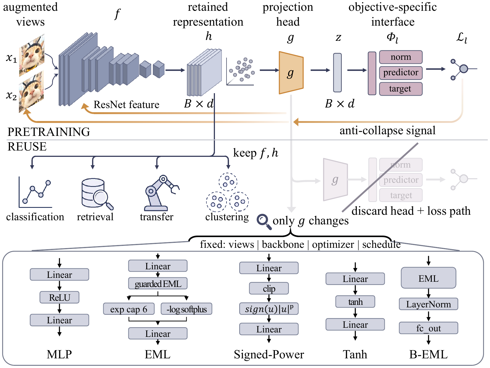

# One Head, Three Regimes

Official code for the KDD 2027 paper *One Head, Three Regimes: Stress-Testing
Anti-Collapse Interfaces in Self-Supervised Learning*. It stress-tests the complete projection-head, loss,
normalization, predictor, and target interface in self-supervised learning.

<p align="center">
  
</p>

## Scope

The repository implements five controlled loss-facing head operators across
multiple SSL objectives:

- MLP: `Linear -> ReLU -> Linear`
- EML: guarded exponential branch capped at 6
- Signed-Power: polynomial branch with inputs clipped to `[-20, 20]`
- Tanh: saturating hidden core followed by a learned output layer
- B-EML: affine LayerNorm on the hidden EML output, followed by `fc_out`

The operators are stress-test interventions, not a universal activation
taxonomy or a ranking of projection heads. The fixed-norm controls constrain
each sample norm only; they do not enforce isotropic covariance or full rank.

## Repository Layout

```text
src/          objective trainers, head implementations, probes, diagnostics
evaluation/   downstream transfer and ImageNet-C evaluation
examples/     portable command-line examples
tests/        lightweight implementation checks
assets/       pipeline figure
```

Training logs, checkpoints, datasets, and machine-specific launch queues are
intentionally excluded.

## Installation

Python 3.10 or newer is recommended.

```bash
python -m venv .venv
source .venv/bin/activate
python -m pip install --upgrade pip
python -m pip install -r requirements.txt
```

Set the source directory on `PYTHONPATH` when invoking evaluation utilities:

```bash
export PYTHONPATH="$PWD/src:$PYTHONPATH"
```

## Quick Checks

Run the head-level smoke tests without downloading a dataset:

```bash
python -m unittest discover -s tests -v
```

Inspect any trainer's complete CLI:

```bash
python src/simclr_cifar.py --help
python src/vicreg_cifar.py --help
python src/dino_cifar.py --help
```

## Example Training

A one-epoch CIFAR-10 smoke run:

```bash
bash examples/cifar10_smoke.sh /path/to/data
```

An ImageNet-100 VICReg run with the Tanh-core head:

```bash
python src/vicreg_cifar.py \
  --dataset imagenet100 \
  --data-root /path/to/imagenet100 \
  --head tanh \
  --backbone resnet18 \
  --epochs 100 \
  --batch-size 128 \
  --seed 0 \
  --device cuda:0 \
  --out-dir outputs/vicreg_tanh_seed0
```

Run a frozen probe from a completed checkpoint:

```bash
python src/linear_probe.py \
  --ckpt outputs/vicreg_tanh_seed0/encoder_final.pt \
  --dataset imagenet100 \
  --data-root /path/to/imagenet100 \
  --epochs 50
```

## Evaluation Notes

`evaluation/run_transfer_probe.py` supports frozen linear and cosine k-NN
evaluation on the downstream datasets implemented in that module.
`evaluation/run_imagenet_c_eval.py` evaluates the selected ImageNet-C
corruptions and severities. Dataset roots and checkpoint paths are supplied
explicitly; no machine-local paths are embedded in the release.

Results depend on the full configured interface and training recipe. Do not
interpret a scalar output statistic, an isolated head label, or a single run as
a general collapse certificate.

## Citation

```bibtex
@inproceedings{zhou2027onehead,
  title     = {One Head, Three Regimes: Stress-Testing Anti-Collapse Interfaces in Self-Supervised Learning},
  author    = {Zhou, Tianjian and Li, Yishan and Jiang, Jie and Zhang, Yifei},
  booktitle = {Proceedings of the 33rd ACM SIGKDD Conference on Knowledge Discovery and Data Mining V.1 (KDD 2027)},
  year      = {2027},
  address   = {San Jose, CA, USA},
  publisher = {ACM},
  doi       = {10.1145/3862868.3871219}
}
```

## License

Released under the [MIT License](LICENSE).
